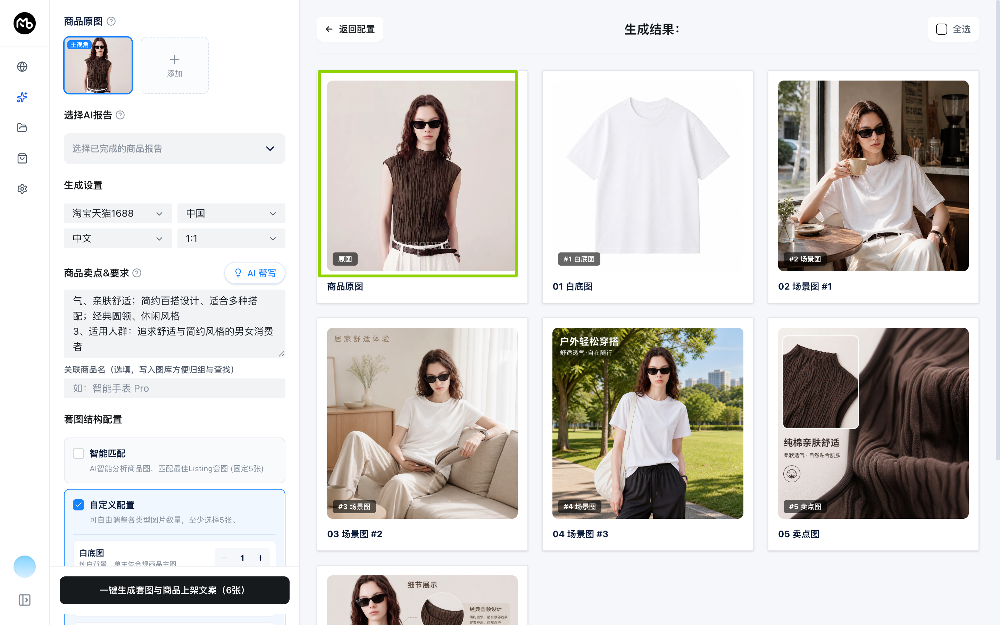
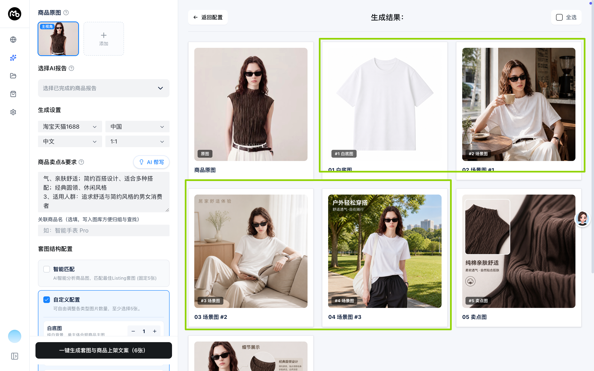
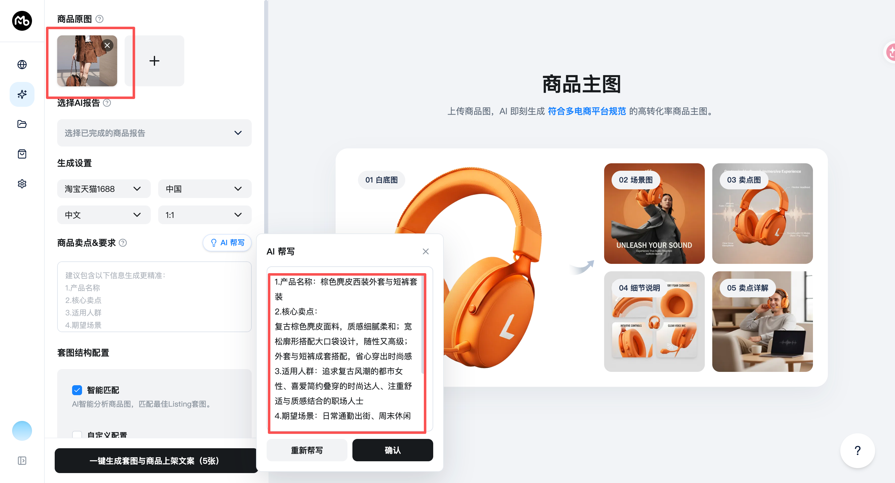

# [问题记录：商品主图-商品识别一致性]

## 📌 一、基本信息

| 属性 | 内容 |
| :--- | :--- |
| **问题编号** | FIX-2026-10-15-01 |
| **所属模块** | AIGC · 商品主图 |
| **记录时间** | 2026-10-15 |
| **运行环境** | 桌面客户端 macOS |
| **逻辑来源** | 人工明确要求 + 对齐 dev 分支旧逻辑 |
| **当前状态** | 已修复待验证 |

---

## 📷 二、人工反馈与现象记录

### 1. 现象描述
商品原图为深棕色、褶皱纹理的无袖上衣；生成的白底图、场景图和卖点图却变成白色短袖，商品颜色、袖型和纹理均不一致。

第二轮反馈中，灰色毛衣原图的 AI 帮写被识别为黑色短靴，并且流式文本出现重复拼接。错误商品信息被确认回填后，后续整套图均会沿用短靴卖点。

### 2. 期望处理方式
无论白底图、场景图还是卖点图，均以用户上传商品原图为唯一商品主体，严格保持原图可见的颜色、品类、袖型、领型、轮廓与纹理；若当前生图供应商不支持参考图，停止生成并明确提示，不能静默生成其他商品。

### 3. 操作复现链路
1. 打开客户端的 `AIGC > 商品主图`；
2. 上传深棕色褶皱无袖上衣并一键生成套图；
3. 查看结果，发现多张生成图被替换为白色短袖商品。

### 4. 截图证据

---

## 🤝 三、方案呈现与用户确认记录

- **排查出的根因**：原先桌面端 AI 帮写先独立识图、再让纯文本模型流式续写，流式请求本身不携带商品图；同时 Worker 输出累计全文，而页面按增量继续拼接，造成重复内容。旧启动的 Electron Worker 也不会自动加载 Worker 源码更新。
- **逻辑对比结论（dev 分支实现 vs 人工明确要求）**：dev 分支以单次视觉流式请求同时传入商品图、当前文案和生成设置，直接输出五项商品信息。用户明确要求商品图必传，文案可选；文案为空时只按商品图整理，文案存在时仅作为不与图片冲突的补充。
- **向用户呈现的建议技术方案**：将两个菜单的 AI 帮写统一为单次视觉流式调用；视觉模型始终收到商品图；流式事件只传本次增量；保留商品图必传校验，并把用户输入改为可空补充上下文。
- **用户确认结果**：2026-10-15，用户明确给出最终业务规则并确认实施。

---

## 🛠️ 四、main-dev 桌面端技术实现与修复落地

### 1. 桌面端改造适配设计
- 在 `ai-provider` 新增视觉流式方法：同一请求内发送文本和商品图，使用视觉模型完成 AI 帮写。
- 在 `product-sets-capability` 中要求 AI 帮写必须有商品图，并把用户文字作为可空补充；图片可见事实与文字冲突时以图片为准。
- 流式事件改为仅传递本次文本增量，商品主图和详情图页面沿用既有累加逻辑即可正常显示。
- 在图位提示词规划中继续使用原图视觉事实，保持生成阶段的商品一致性。
- 在 LangGraph 套图规划节点透传 `mainImage` 与 `images`。
- 仅 OpenRouter 图像接口已实现参考图请求；其他配置收到参考图时中止并提示用户切换至支持参考图的模型，避免误图。

### 2. 代码涉及文件
- Worker：`apps/desktop/src/worker/product-sets-capability.ts`
- Worker：`apps/desktop/src/worker/ai-provider.ts`
- Worker：`apps/desktop/src/worker/image-prompt.ts`
- Worker：`apps/desktop/src/worker/index.ts`
- Worker：`apps/desktop/src/worker/image-capability.ts`

---

## 🧪 五、自动化测试与实测取证

- [x] TypeScript 类型检查通过：`corepack pnpm --filter desktop typecheck`
- [x] 单元测试通过：`corepack pnpm --filter desktop exec vitest run src/worker/product-sets-capability.spec.ts src/worker/image-prompt.spec.ts src/worker/image-capability.spec.ts --no-file-parallelism --maxWorkers=1`（16/16）
- [ ] 客户端界面手动验证通过：待使用支持参考图的真实图像模型生成一组商品图确认。

---

## ✅ 六、业务验收标准

- [x] 1. 原图视觉事实进入帮写与图位规划，颜色、品类、袖型、领型、轮廓和纹理被锁定；
- [x] 2. 批量套图工作流向规划阶段传递商品原图；
- [x] 3. 不支持参考图的供应商不会静默产出错误商品；
- [x] 4. AI 帮写要求商品图必传；用户文案可空，存在时只作为不与图片冲突的补充；
- [x] 5. AI 帮写视觉流式请求携带商品图，页面不再重复拼接累计文本；
- [ ] 6. 使用真实支持参考图的模型验证 AI 帮写、白底图、场景图和卖点图均与原图商品一致。
