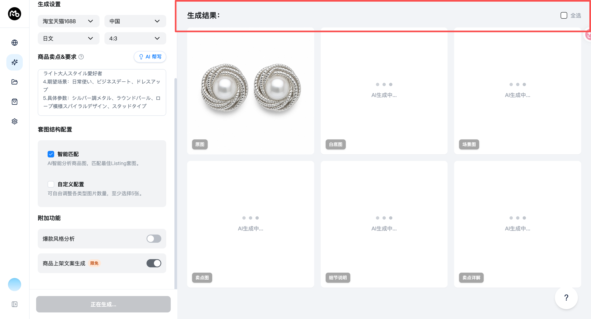
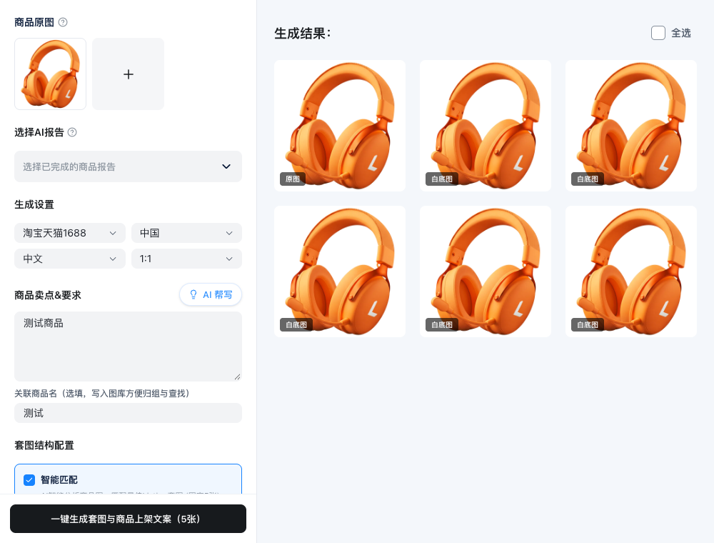

# 商品主图：结果区横线与间距

- 编号：FIX-2026-10-16-03
- 来源：用户明确要求删除“生成结果”标题下方横线，并调整间距。
- 状态：已修复待客户端验收。
- 原因：顶栏存在底边框、16px 底部内边距和24px 底部外边距，造成分隔线和较大留白。
- 修改：仅修改 `apps/desktop/src/renderer/src/pages/ProductImageSetsPage.tsx` 顶栏样式，移除底边框和底部内边距，标题操作栏与图片网格保留16px间距。生成、全选和批量操作逻辑不变。
- 验证：类型检查、`git diff --check` 通过；浏览器在1000×760、1440×900下检查底边框为0、底部内边距为0、与网格间距为16px，无页面异常。验证使用独立上下文及模拟资产数据。

