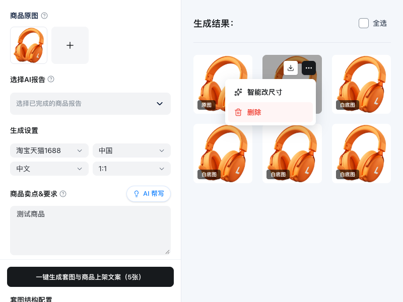

# 商品主图：菜单层级、表单圆角与原图上传交互修复

## 一、基本信息

| 属性 | 内容 |
| :--- | :--- |
| 问题编号 | FIX-2026-10-16-01 |
| 所属模块 | AIGC · 商品主图 |
| 记录时间 | 2026-10-16 |
| 运行环境 | main-dev 桌面端渲染层 |
| 逻辑来源 | 用户明确提出的 4 项要求，参考本地 origin/dev |
| 当前状态 | 已修复待客户端验收 |

## 二、用户反馈与验收要求

1. 小窗口下，“更多操作”菜单被图片卡片遮挡；要求浮在上层，菜单选项完整可点击。
2. 当前页面的选择框、输入框、文本域统一为 8px 圆角。
3. 商品原图参考图 3：统一缩略图样式；取消首张“主视角”、蓝边与悬浮遮罩、设主图入口；悬浮时仅在右上角显示删除图标。
4. 超过 6 张时，保留前 6 张，并提示“同一产品最多上传 6 张图片，已保留前 6 张”。

### 反馈截图

- [图 1：菜单遮挡](./images/2026-10-16-商品主图-菜单遮挡.png)
- [图 2：表单圆角](./images/2026-10-16-商品主图-表单圆角.png)
- [图 3：上传区期望效果](./images/2026-10-16-商品主图-上传区期望效果.png)
- [图 4：需要移除的主视角样式](./images/2026-10-16-商品主图-主视角样式移除.png)

## 三、根因与方案依据

- 菜单原来绝对定位在图片卡片内部；卡片的 `overflow-hidden` 会裁切菜单，单纯增加子元素 `z-index` 无效。
- Arco Select 的背景、边框由内部 `.arco-select-view` 绘制；外层 `style.borderRadius` 不能统一内部圆角。Arco 未分层样式还会覆盖 Tailwind 圆角类。
- 原图区域显式实现了首图主视角标签、蓝色描边、整图黑色悬浮遮罩和居中的操作按钮，与用户提供的图 3 不一致。
- 上传仅截取剩余可用数量，截断时仍提示成功；只有已满 6 张时才警告。逐个 FileReader 完成后追加还可能改变选图顺序。
- 已查看 `origin/dev:app/src/app/pages/ProductImageSets.tsx`：旧版使用 `Promise.all` 保持选择顺序，并在截断图片时提示已保留前 6 张。菜单本次采用当前桌面端已有 Arco Trigger 的顶层弹出能力。
- 用户已在本次请求中明确列出修复内容、最终视觉效果和提示文案，依此直接实施；未增加新的业务选择或修改生图接口。

## 四、实现范围

### `apps/desktop/src/renderer/src/pages/ProductImageSetsPage.tsx`

- 使用 Arco Trigger，将菜单挂载至 `document.body`，层级高于结果卡片；启用视口自动避让、鼠标移入菜单保持显示和滚动关闭，支持 Escape 关闭。菜单打开时保持对应图片操作层显示。
- 原图改为四列等宽正方形缩略图，完整展示图片，统一浅色边框；右上角悬浮垃圾桶删除按钮；追加入口仅显示加号。
- 移除主视角显示和设主图入口，保留现有内部主图引用逻辑，避免影响生成流程。
- 一批图片全部读取后按选择顺序追加，限制总数为 6；超限显示用户要求的完整文案；读取失败给出错误提示；读取中重复添加给出等待提示。

### `apps/desktop/src/renderer/src/styles.css`

- 增加 `.product-image-sets-page` 限定的 Arco 表单圆角规则，作用于实际背景/边框节点，圆角均为 8px。
- 本次未修改 Worker、IPC、后端、AI 模型配置或依赖。

## 五、验证

- [x] TypeScript：在 `apps/desktop` 执行 `node node_modules/typescript/bin/tsc --noEmit`，通过。
- [x] 桌面端全量单元测试：19 个文件、69 项全部通过。
- [x] `git diff --check`，通过。
- [x] 浏览器实测 800×600、1000×760、1440×900：菜单在卡片外完整显示，命中测试确认按钮位于上层；从触发按钮移入菜单保持显示；“智能改尺寸”可打开弹窗。
- [x] 浏览器检查 4 个 Select、文本域、商品名输入框的 computed style：圆角均为 8px。
- [x] 一次选择 7 张，仅显示前 6 张且顺序正确，并出现精确超限提示；删除后已有 5 张再追加 2 张，仅补入第一张。
- [x] 原图没有主视角标记和蓝边；仅一个右上角删除按钮，默认隐藏、悬浮显示；删除生效。
- [x] 菜单 Escape、点击外部、滚动关闭均通过；菜单删除操作命中对应模拟资产。
- [x] 800×300 底部菜单自动避让窗口边缘；恰好上传 6 张正常成功且不出现超限提示。
- [x] 浏览器自动化期间无页面异常。
- [ ] 用户在 Electron 客户端确认最终显示效果。

测试环境说明：运行环境提供的 pnpm 默认会检查并尝试重装依赖。测试使用当前已安装依赖，设置 `pnpm_config_verify_deps_before_run=false` 防止测试内的 Prisma 迁移触发重装；数据库初始化并发耗时超过默认 5 秒，测试超时放宽至 20 秒。未修改仓库依赖配置。

```sh
# 在 apps/desktop 下执行
node node_modules/typescript/bin/tsc --noEmit
pnpm_config_verify_deps_before_run=false node node_modules/vitest/vitest.mjs run --testTimeout=20000 --hookTimeout=20000
```

浏览器验证使用实际页面源码与本地现有 Vite 服务，独立 Chrome 上下文，报告/生成资产 IPC 使用模拟数据；没有访问用户登录信息、真实资产或调用付费生成服务。客户端人工验收仍待用户完成。

### 修复后的浏览器验证截图




