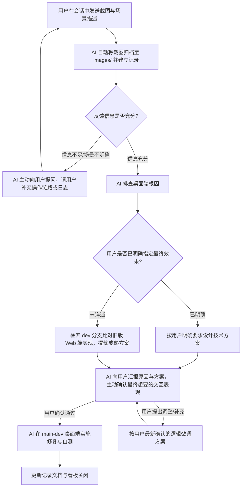

# 对齐 dev 分支问题修复与协作规范 (Issue Feedback & dev Alignment)

> 📢 **定位说明**：
> 本目录用于沉淀在桌面端（`main-dev`）体验与测试过程中人工反馈的异常、场景描述及最终修复方案。

---

## 🔄 协同运作机制

---

## 📋 职责与执行要点

### 1. 用户反馈
- 在会话中直接提供问题截图与场景描述；
- 若已有明确的预期交互或处理逻辑（如：空态置灰、防止重复请求等），可直接在描述中说明。

### 2. AI 承接、追问与排查
- **自动归档**：将用户提供的截图自动保存至 `images/` 目录，并按模板创建排查记录；
- **主动发问补全信息**：如果仅凭截图或简短描述无法定位具体前置操作、触发条件或所属数据，**严禁凭空假设，必须主动向用户提问，请用户补充必要信息**；
- **根因分析**：排查 `main-dev` 桌面端代码；
- **旧版对标**：若需明确业务细节，通过 `git show dev:...` 或 `git grep ... dev` 比对 `dev` 分支原有的成熟实现。

### 3. 方案确认与最终诉求对齐（必须闭环）
- **主动对齐最终诉求**：AI 必须向用户清楚说明：
  1. 导致问题的根因是什么；
  2. `dev` 分支旧版是如何做的；
  3. 计划采用的方案是什么，**并主动与用户确认“这是不是您最终想要的效果与逻辑”**；
- **确认后才执行**：只有在用户明确确认逻辑、达成共识后，才正式开始修改代码。

### 4. 实施与验证
- 在当前桌面端架构（Electron + Worker + SQLite + 本地资产）下落实修复；
- 跑通类型检查（`typecheck`）与单元测试（`test`）；
- 更新本看板状态。

---

## 📊 修复记录看板

| 编号 | 记录日期 | 涉及模块 | 问题简述 | 逻辑来源 (人工明确 / 对齐dev) | 处理状态 | 关联文档 |
| :--- | :--- | :--- | :--- | :--- | :--- | :--- |
| FIX-示例 | YYYY-MM-DD | 示例模块 | 简要描述问题现象 | 人工明确 / 对齐dev | 待排查 / 待用户确认 / 已修复待验证 / 已关闭 | [查看模板](./TEMPLATE-对齐dev分支问题修复记录.md) |
