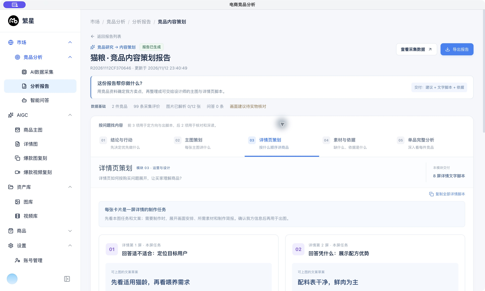

# 竞品内容策划页 · 展示结构 PRD

| 项目 | 内容 |
|---|---|
| 版本 | v1.3 |
| 日期 | 2026-11-12 |
| 页面 | 市场 → 竞品分析 → 分析报告 → 查看出图方案 |
| 需求来源 | 用户反馈：进入页面后，不清楚各区域分别在讲什么 |
| 本版目标 | 让用户知道“这是什么、先看什么、这一块能得到什么、接下来怎么用” |
| 当前状态 | 已完成本地实现与验证，待业务验收 |
| 样例 | 猫粮报告：2 件竞品、99 条采集评价、5 张主图文字脚本、8 屏详情文字脚本 |

## 1. 背景与问题

上一版通过“一句话结论”和重点卡片减少了文字负担，但仍有理解门槛：

| 现有问题 | 用户容易产生的疑问 | 本次处理 |
|---|---|---|
| 只有“重点”“下一步”等概括性标签 | 这是竞品事实，还是让我照做的建议？ | 卡片固定分为“竞品发现”和“我方建议动作” |
| “主图脚本”“完整分析”缺少用途说明 | 点进去会看到图片、文案，还是研究过程？ | 导航增加问题说明；模块说明交付内容 |
| 一句话结论在所有标签页重复出现 | 当前看的究竟是方案还是依据？ | 将建议方向放回“结论与行动”，每个模块显示自己的标题与目的 |
| 制作条件、原始证据与研究全文分散 | 素材还缺什么，哪些信息要核实？ | “素材与依据”集中提供准备清单、使用边界及原文 |
| 点击依据后仍需寻找目标内容 | 这项建议到底对应哪条评价？ | 切换到对应模块，并定位、筛选、聚焦证据原文 |

## 2. 用户与核心任务

| 角色 | 进入页面要完成的任务 | 优先阅读区域 |
|---|---|---|
| 运营 / 店长 | 判断竞品信号，确定我方优先做什么 | 01 结论与行动 |
| 内容策划 / 设计师 | 理解每张图的任务、文案、画面和素材要求 | 02 主图策划、03 详情页策划 |
| 资料准备人员 | 找出我方尚缺的实物、参数、标签和授权资料 | 04 素材与依据 |
| 竞品分析人员 | 查看单品推导过程、样本范围和证据 | 04 素材与依据、05 单品完整分析 |

**主要使用路径：** 看懂用途 → 读结论与行动 → 选择主图或详情页策划 → 核实依据、补齐我方资料 → 复制脚本交给设计或导出报告。

## 3. 目标与范围

### 3.1 体验目标

- 首次进入即可说明：这是把竞品研究转为我方内容方向的策划报告，当前交付包含建议、文字脚本和依据。
- 用户能在点击前预测每个导航项的内容。
- 用户能区分竞品事实、我方建议、可上图文案草案和待补资料。
- 从任一建议或脚本出发，一次点击可到达其对应证据。
- 完整资料保留，主要操作无需先读完单品研究全文。

以上为体验目标，尚未开展正式用户可用性研究，不作为已达成的量化效果。

### 3.2 本版范围

调整页面信息层级、名称、说明、导航、展开方式、证据定位，以及导出报告的阅读结构。保留原有采集数据、报告生成、复制和导出能力。

本版不新增自动生图、素材上传、任务分派或素材完成状态跟踪。页面上的“待补素材”是准备清单，不表示已具备上传或勾选管理能力。

## 4. 整体信息结构

```text
页面身份：商品名 · 竞品内容策划报告
  ├─ 报告编号、更新时间、报告已生成状态
  ├─ 查看采集数据 / 导出报告
  ├─ 报告用途：帮谁做什么，最终交付什么
  ├─ 数据基础：竞品数、评价数、图片实际解析数、问答数
  └─ 阅读导航（数字表示阅读顺序，不表示任务完成进度）
      ├─ 01 结论与行动：先决定优先做什么
      ├─ 02 主图策划：每张主图讲什么
      ├─ 03 详情页策划：按什么顺序讲商品
      ├─ 04 素材与依据：缺什么、依据是什么
      └─ 05 单品完整分析：深入看每件竞品

当前模块
  ├─ 模块编号 + 适用角色
  ├─ 模块名称 + 要回答的问题
  ├─ 本模块交付
  ├─ 当前内容的复制入口
  └─ 具体内容 / 按需展开的细节 / 下一步入口
```

### 4.1 顶部身份与用途

| 元素 | 展示规则 |
|---|---|
| 页面标题 | 优先显示“{关键词} · 竞品内容策划报告”；关键词缺失时使用已有报告标题 |
| 报告状态 | 有可展示的策划结果时显示“报告已生成”，不把脚本数量写成图片生成数量 |
| 用途标题 | 固定为“这份报告帮你做什么？” |
| 用途说明 | “用竞品资料确定我方卖点，再整理成可交给设计师的主图与详情页脚本。” |
| 交付标记 | “交付：建议 + 文字脚本 + 依据” |
| 数据基础 | 区分采集量和实际解析量，例如“99 条采集评价”“图片已解析 0/12 张” |
| 数据缺口 | 图片未解析时补充“画面建议待实物核对”，不能把图片记录数当成解析成功数 |
| 主操作 | 查看采集数据；导出报告 |

### 4.2 导航规则

采用两行导航：第一行模块名称，第二行说明用途。导航顺序固定为 01–05。默认进入 01。

| 编号 | 名称 | 导航说明 | 要回答的问题 | 本模块交付 |
|---|---|---|---|---|
| 01 | 结论与行动 | 先决定优先做什么 | 竞品有哪些值得参考的信号，我方应优先做什么？ | 最多 3 项优先建议 |
| 02 | 主图策划 | 每张主图讲什么 | 每张主图要突出什么卖点，文案和画面怎么安排？ | 实际数量的主图文字脚本 |
| 03 | 详情页策划 | 按什么顺序讲商品 | 详情页如何按购买问题展开，让买家理解商品？ | 实际数量的详情文字脚本 |
| 04 | 素材与依据 | 缺什么、依据是什么 | 还要准备哪些我方素材，建议又来自哪些竞品资料？ | 待补素材清单 + 竞品证据 |
| 05 | 单品完整分析 | 深入看每件竞品 | 每件竞品的卖点、人群、场景和痛点，是怎样分析出来的？ | 各竞品分析过程与样本范围 |

普通切换：清除此前的证据筛选，滚动至模块顶部。长内容阅读时，桌面端导航在报告容器内保持可见。方向键、Home 和 End 可切换标签；焦点样式清晰。

## 5. 分模块设计

### 5.1 01 结论与行动

**目的：** 让运营先确定方向，再决定要交给设计什么任务。

展示顺序：

1. **本次建议方向**：用一句话表达优先方向，只在本模块出现。
2. **优先行动**：最多 3 张卡片，按建议顺序排列。
3. **接下来怎么用**：跳转主图策划或详情页策划。
4. **制作前再确认**：跳转素材与依据。

每张重点卡片统一包含：优先序号、行动主题、竞品发现、我方建议动作、核对依据入口。竞品发现回答“为什么这样判断”；我方建议动作回答“接下来具体做什么”。不把竞品评价直接写成我方效果或承诺。

**猫粮样例：** 首屏展示冻干实物 → 用配料表建立信任 → 肠胃相关表述核实后再用。原始研究中存在的正反反馈仍须保留。

### 5.2 02 主图策划

**目的：** 告诉设计每张主图要完成哪项沟通任务。

顶部解释：“每张卡片是一张主图的制作任务”。主图数量按实际报告显示，不在界面写死。

| 卡片内容 | 默认状态 | 用户能知道什么 |
|---|---|---|
| 主图编号 + 本图任务 | 可见 | 这张图要解决什么问题 |
| 可上图的文案草案 | 可见、视觉突出 | 图上准备写什么 |
| 画面安排 | 点击展开 | 设计如何构图和排版 |
| 所需素材与使用条件 | 点击展开 | 缺什么、什么情况下能使用 |
| 制作简报 | 进一步展开，可复制 | 可以交给设计或作图工具的说明 |
| 核对本图依据 | 可见 | 回看这张图所引用的竞品原文 |
| 复制本图脚本 | 可见 | 一次复制任务、文案、画面、材料、简报和证据 |

不展示虚构的成品图片、完成率或已审核状态。文案草案须在核实我方信息后使用。

### 5.3 03 详情页策划

结构与主图策划一致，但单位为“屏”。顶部解释：“每张卡片是一屏详情的制作任务”。

屏序表示建议的讲述顺序；每屏围绕一个购买问题展开。用户可先浏览全部屏的任务和文案，再展开需要制作的屏。提供“复制全部详情脚本”和“复制本图脚本”。

### 5.4 04 素材与依据

将准备工作与已采集资料明确区分：

| 区域 | 内容与用途 | 默认状态 |
|---|---|---|
| 制作准备｜我方还要补什么 | 我方实物、包装、标签、参数、规格等待补资料；另列数据局限及使用边界 | 展开 |
| 证据原文｜建议具体来自哪里 | 标题、评价等原始文本，保留类型和商品来源，支持搜索 | 展开；普通进入先显示 8 条，可展开全部 |
| 竞品发现汇总 | 将多条资料归纳出的发现与建议动作 | 折叠 |
| 竞品原图参考 | 原图供人工核对，明确“展示原图不等于已完成 AI 图片解析” | 折叠 |

**从建议 / 脚本进入证据的特殊路径：** 切换到 04 → 仅显示对应证据 → 滚动并聚焦“证据原文” → 显示筛选说明 → 可点击“查看全部证据”退出筛选。返回后再次点击同一依据，仍应正确定位。

“查看全部证据”仅解除关联来源筛选；搜索框的文字条件继续保留。用户可清空搜索框恢复全部匹配资料。

### 5.5 05 单品完整分析

**目的：** 供需要深读的人核对推导过程，不作为默认入口。

先说明“先读单品结论，需要细节时再展开全文”。每件商品展示标题、单品结论、实际样本量；八模块分析及更细的证据解析按需展开。旧报告若已有完整研究正文，则继续展示该正文，不重写或补造研究结论。

## 6. 交互、状态与异常

| 场景 | 处理 |
|---|---|
| 首次打开 / 刷新 | 默认停在 01；模块标题、问题和交付内容一起出现 |
| 点击模块导航 | 展示所选模块，保留报告身份，更新高亮，不重新请求 AI |
| 点击重点或脚本的依据 | 进入 04，直接定位到筛选后的原文，焦点可见 |
| 缺少可核对依据 | 显示“待补依据”，核对按钮禁用；不编造来源 |
| 搜索无结果 | 显示“没有匹配的证据，请调整搜索条件” |
| 原图加载失败 | 说明可先查看标题和评价依据，并提供重新读取 |
| 没有可展示原图 | 显示明确空状态，不能只留下空白区域 |
| 缺少重点摘要的旧报告 | 优先复用已有内容；无摘要时说明可查看脚本及单品分析 |
| 复制失败 | 明确提示失败，不误报成功 |
| 导出中 / 失败 | 导出中禁用重复操作；失败后显示原因并允许重试 |
| 报告无法读取 | 保留原有错误说明与返回报告列表入口 |

## 7. 视觉与文案规范

- 标题层级：页面名称 → 当前模块 → 区域用途 → 内容卡片。避免所有标题同样大、同样重。
- 模块说明统一采用“给谁看 + 解决什么问题 + 交付什么”，不以“更多”“内容”“重点”等泛词单独命名。
- 深色结论区只用于 01 的建议方向；脚本使用文案突出区，依据使用中性原文区。颜色辅助层级，不能成为唯一标识。
- 不使用时间、成功率、素材审核进度等未采集数据装饰页面。
- 以 1440 × 900 桌面窗口为主要设计参考。窄窗口允许导航换行、重点卡片减列；文字保持可读，折叠按钮和主操作不能被挤出容器。
- 键盘可到达导航、展开项、复制和导出按钮；使用清晰焦点描边。标题结构与标签页语义一致。
- 详细内容可以折叠，但数据基础和关键缺口仍须可见。

## 8. 导出阅读结构

HTML 阅读版按同样的 01–05 模块组织，提供用途说明和锚点导航；脚本、证据及完整研究按需展开。Markdown 使用同样的模块标题，并保留全部内容便于检索和流转。JSON 保留完整结构化数据。

导出保持来源、脚本顺序和限制条件，不把文字脚本改称图片成品。页面结构调整不能删除既有原始证据。

## 9. 业务验收标准

| 编号 | 验收项 | 通过标准 |
|---|---|---|
| AC-01 | 入口身份 | 首屏同时有商品主题、报告用途与文字脚本交付说明 |
| AC-02 | 导航可预测 | 五项导航均有独立名称和用途说明，不进入模块也可判断其内容 |
| AC-03 | 模块定位 | 任一模块都明确显示适用角色、要回答的问题和交付内容 |
| AC-04 | 事实与建议区分 | 重点卡片清楚标记“竞品发现”和“我方建议动作” |
| AC-05 | 阅读路径 | 可从 01 一次点击进入 02、03 或 04 |
| AC-06 | 脚本含义 | 02 以张、03 以屏表达文字制作任务，默认先显示任务和文案 |
| AC-07 | 细节保留 | 展开后可查看画面、材料、使用条件和制作简报 |
| AC-08 | 证据定位 | 从任一可用依据入口一次点击到达对应原文，筛选正确，焦点不被导航遮挡 |
| AC-09 | 重复定位 | 反复核对相同来源，也能重新定位原文 |
| AC-10 | 准备清单 | 04 将我方待补资料和竞品已采集资料分别命名展示 |
| AC-11 | 数据口径 | 采集评价量和图片实际解析量分别展示，0/12 不得显示为 12 张已解析 |
| AC-12 | 原图状态 | 加载、失败、无图三种情况都有说明，不阻塞文字证据阅读 |
| AC-13 | 完整研究 | 05 可读取原有单品分析，保留样本范围及原文来源 |
| AC-14 | 操作反馈 | 复制、导出分别反馈成功或失败，不误报 |
| AC-15 | 导出一致 | HTML、Markdown 阅读模块顺序与页面一致，原始内容不丢失 |
| AC-16 | 兼容旧报告 | 无新增摘要字段的历史报告也能打开 |
| AC-17 | 可访问性 | 键盘可切换标签并展开细节；当前模块和焦点可识别 |
| AC-18 | 无额外生成 | 普通阅读、切换、搜索和复制不会触发新的模型生成任务 |

## 10. 验证与后续评估

本地验证记录：15 项相关测试通过；TypeScript 检查与生产编译通过。桌面端已核对用途说明、五项导航、模块目的与交付、脚本到证据的直接定位，以及键盘切换到单品分析。HTML 导出已保留五模块和全部内容。

待业务验收：请运营或设计人员首次打开页面，在不提示的情况下说明“页面用途、下一步动作、脚本位置、依据位置”。记录无法理解的标签，再调整文案。目标为多数受测者可在 30 秒内回答上述问题；本版尚无实测数据。

## 11. 研发对照

| 功能 | 工程位置 |
|---|---|
| 页面身份、用途、导航与模块切换 | `apps/desktop/src/renderer/src/components/CreativeReportView.tsx` |
| 导航名称、用途和模块交付说明 | `apps/desktop/src/renderer/src/components/ReportSectionGuide.tsx` |
| 结论与行动、去向入口 | `apps/desktop/src/renderer/src/components/CreativeReportOverview.tsx` |
| 单品完整分析 | `apps/desktop/src/renderer/src/components/SkillProductReports.tsx` |
| 页面样式 | `apps/desktop/src/renderer/src/styles/creative-report.css` |
| Markdown / HTML 导出 | `apps/desktop/src/shared/creative-report.ts`、`creative-report-html.ts` |

本版只调整展示和阅读组织，不新增数据库表，不更改采集结果及模型凭证。

## 12. 页面预览

以下为本地样例报告的实际页面截图，用于对照模块名称和信息层级：


